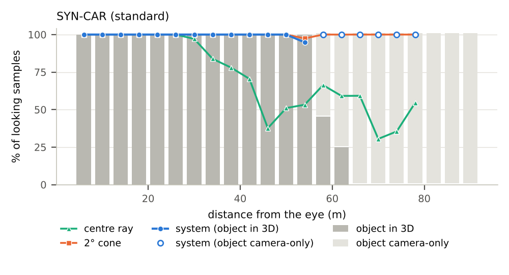
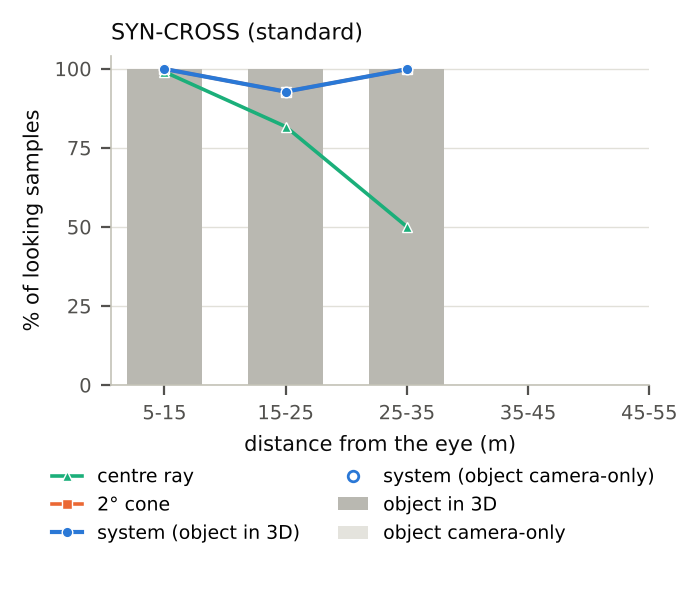
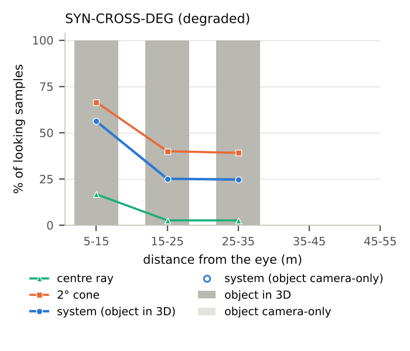
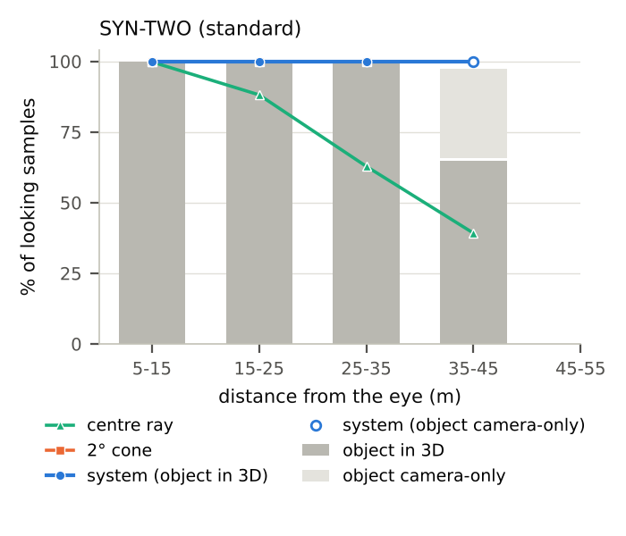
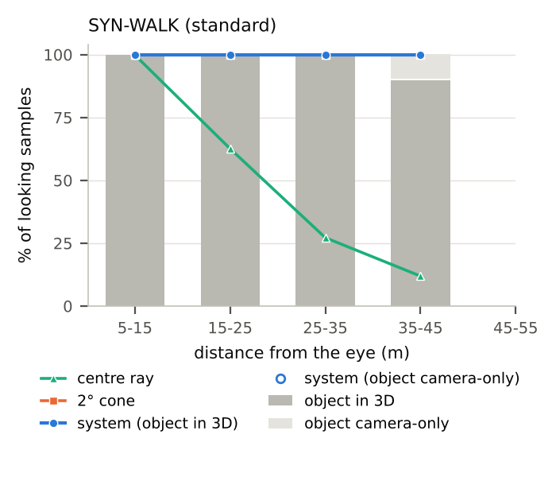
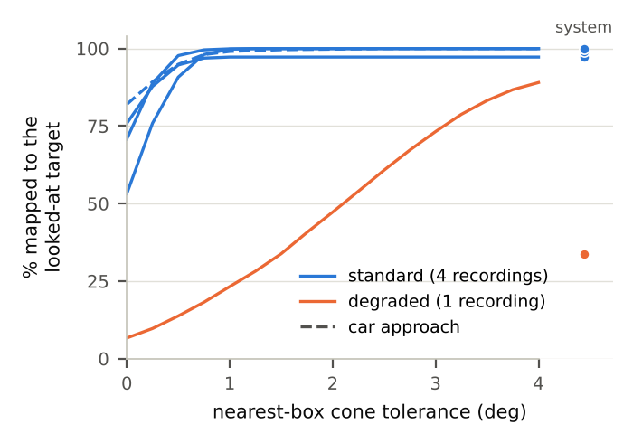

# Gaze-to-object mapping evaluation

goeval 0.1.1. Settings that differ from the defaults: none.

## Recordings

| recording | protocol | condition | rate_hz | units | target_ids | notes |
|---|---|---|---|---|---|---|
| SYN-CAR | car_approach | standard | 50.0 | 2 | [10, 11] | blinks from: DMS blink counter |
| SYN-CROSS | crossing | standard | 50.0 | 9 | [1] | blinks from: DMS blink counter |
| SYN-CROSS-DEG | crossing | degraded | 50.0 | 9 | [1] | blinks from: DMS blink counter |
| SYN-TWO | two_pedestrians | standard | 50.0 | 4 | {"L": [1], "R": [2]} | blinks from: DMS blink counter |
| SYN-WALK | walkaway | standard | 50.0 | 4 | [1, 11] | blinks from: DMS blink counter |

## Tables

**Gaze input to the mapping** (per recording; units = stops, repeats or looks; median absolute yaw bias over units, its maximum, and median precision over units, deg)

| Recording | Condition | Units | Median abs. yaw bias | Max abs. yaw bias | Yaw precision | Pitch precision |
|---|---|---|---|---|---|---|
| SYN-CROSS | standard | 7 | 0.64 | 0.75 | 0.30 | 0.43 |
| SYN-CROSS-DEG | degraded | 7 | 2.15 | 3.26 | 1.17 | 1.55 |
| SYN-TWO | standard | 8 | 0.50 | 0.60 | 0.34 | 0.44 |
| SYN-WALK | standard | 4 | 0.70 | 0.93 | 0.27 | 0.40 |

**Looking samples mapped to the looked-at object (%): system / 2° cone / centre ray**, by distance from the eye (all phases). Cells with less than 3 s of looking are left out.

| Recording | Condition | 5-15 m | 15-25 m | 25-35 m | 35-45 m | 45-55 m | Competitor within 2° (% of samples) |
|---|---|---|---|---|---|---|---|
| SYN-CAR | standard | 100 / 100 / 100 | 100 / 100 / 100 | 100 / 100 / 97 | 100 / 100 / 68 | 98 / 99 / 48 | 32 |
| SYN-CROSS | standard | 100 / 100 / 99 | 93 / 93 / 82 | 100 / 100 / 50 | – | – | 53 |
| SYN-CROSS-DEG | degraded | 56 / 67 / 17 | 25 / 40 / 3 | 25 / 39 / 3 | – | – | 13 |
| SYN-TWO | standard | 100 / 100 / 100 | 100 / 100 / 88 | 100 / 100 / 63 | 97 / 100 / 39 | – | 0 |
| SYN-WALK | standard | 100 / 100 / 100 | 100 / 100 / 63 | 100 / 100 / 27 | 99 / 100 / 12 | – | 0 |

**Standing vs walking** (all distances): system / cone / centre ray, and seconds of looking.

| Recording | Condition | Standing | s | Walking | s |
|---|---|---|---|---|---|
| SYN-CROSS | standard | 97 / 97 / 75 | 28.4 | 97 / 97 / 77 | 47.5 |
| SYN-CROSS-DEG | degraded | 38 / 52 / 10 | 27.7 | 31 / 45 / 5 | 48.1 |
| SYN-TWO | standard | 99 / 100 / 69 | 30.1 | 99 / 100 / 74 | 23.7 |
| SYN-WALK | standard | 100 / 100 / 53 | 18.1 | 100 / 100 / 54 | 22.7 |

**Samples with another object within 2° of the gaze**: % mapped to the looked-at object.

| Recording | Looking time with a competitor (s) | Share of looking samples (%) | System | Cone |
|---|---|---|---|---|
| SYN-CAR | 6.9 | 32 | 100.0 | 100.0 |
| SYN-CROSS | 40.1 | 53 | 94.8 | 94.8 |
| SYN-CROSS-DEG | 10.2 | 13 | 64.4 | 65.6 |

## Crossings

| recording | condition | crossings | seconds | target_in_3d_pct | target_camera_only_pct | system | cone | centre_ray | system_other | system_none | along_track_err_median_deg | lateral_speed_median_m_s | competitor_pct | system_with_competitor | cone_with_competitor | depth_m | direction |
|---|---|---|---|---|---|---|---|---|---|---|---|---|---|---|---|---|---|
| SYN-CROSS | standard | 6 | 31.5 | 100.0 | 0.0 | 99.5 | 99.5 | 76.1 | 0.5 | 0.0 | 0.2 | 1.3 | 25.1 | 98.0 | 98.0 | all | all |
| SYN-CROSS | standard | 2 | 10.8 | 100.0 | 0.0 | 99.8 | 99.8 | 98.2 | 0.2 | 0.0 | 0.3 | 1.3 | 33.8 | 99.5 | 99.5 | 13.0 | all |
| SYN-CROSS | standard | 2 | 10.9 | 100.0 | 0.0 | 98.7 | 98.7 | 78.6 | 1.3 | 0.0 | 0.2 | 1.3 | 25.2 | 94.9 | 94.9 | 23.0 | all |
| SYN-CROSS | standard | 2 | 9.8 | 100.0 | 0.0 | 100.0 | 100.0 | 48.9 | 0.0 | 0.0 | 0.1 | 1.2 | 15.5 | 100.0 | 100.0 | 33.0 | all |
| SYN-CROSS | standard | 3 | 16.1 | 100.0 | 0.0 | 99.6 | 99.6 | 69.3 | 0.4 | 0.0 | 0.7 | 1.3 | 30.9 | 98.8 | 98.8 | all | L->R |
| SYN-CROSS | standard | 3 | 15.4 | 100.0 | 0.0 | 99.4 | 99.4 | 83.1 | 0.6 | 0.0 | -0.4 | 1.3 | 19.1 | 96.6 | 96.6 | all | R->L |
| SYN-CROSS-DEG | degraded | 6 | 32.4 | 100.0 | 0.0 | 35.5 | 50.1 | 6.1 | 1.6 | 62.9 | -0.1 | 1.3 | 6.1 | 68.7 | 68.7 | all | all |
| SYN-CROSS-DEG | degraded | 2 | 11.4 | 100.0 | 0.0 | 59.7 | 73.4 | 15.1 | 4.6 | 35.7 | 0.9 | 1.3 | 12.9 | 57.5 | 57.5 | 13.0 | all |
| SYN-CROSS-DEG | degraded | 2 | 11.1 | 100.0 | 0.0 | 20.1 | 35.8 | 0.7 | 0.0 | 79.9 | -0.7 | 1.3 | 4.7 | 100.0 | 100.0 | 23.0 | all |
| SYN-CROSS-DEG | degraded | 2 | 9.9 | 100.0 | 0.0 | 24.9 | 39.3 | 1.6 | 0.0 | 75.1 | -0.7 | 1.3 | 0.0 | nan | nan | 33.0 | all |
| SYN-CROSS-DEG | degraded | 3 | 17.1 | 100.0 | 0.0 | 41.6 | 53.7 | 8.4 | 3.0 | 55.4 | -2.1 | 1.3 | 11.5 | 69.4 | 69.4 | all | L->R |
| SYN-CROSS-DEG | degraded | 3 | 15.3 | 100.0 | 0.0 | 28.7 | 45.9 | 3.4 | 0.0 | 71.3 | 2.7 | 1.3 | 0.1 | 0.0 | 0.0 | all | R->L |

## Car approach phases

| recording | condition | approach | enters_3d_at_m | mapped_in_3d_from_m | lead_in_camera_only_s | lead_in_attended_pct | in3d_beyond_s | in3d_beyond_attended_pct | in3d_beyond_cone_pct | in3d_within_s | in3d_within_attended_pct |
|---|---|---|---|---|---|---|---|---|---|---|---|
| SYN-CAR | standard | approach 1 | 61.2 | 61.2 | 5.2 | 100.0 | 0.0 | nan | nan | 11.7 | 99.3 |
| SYN-CAR | standard | approach 2 | 62.6 | 62.6 | 4.8 | 100.0 | 0.0 | nan | nan | 11.7 | 100.0 |

## Robustness

Look gate:

| recording | gate_deg | seconds | system | cone |
|---|---|---|---|---|
| SYN-CAR | 5.0 | 21.7 | 99.6 | 99.8 |
| SYN-CAR | 10.0 | 21.7 | 99.6 | 99.8 |
| SYN-CAR | 15.0 | 21.7 | 99.6 | 99.8 |
| SYN-CROSS | 5.0 | 75.9 | 97.3 | 97.3 |
| SYN-CROSS | 10.0 | 75.9 | 97.3 | 97.3 |
| SYN-CROSS | 15.0 | 75.9 | 97.3 | 97.3 |
| SYN-CROSS-DEG | 5.0 | 57.8 | 40.9 | 56.2 |
| SYN-CROSS-DEG | 10.0 | 75.8 | 33.8 | 47.3 |
| SYN-CROSS-DEG | 15.0 | 75.8 | 33.8 | 47.3 |
| SYN-TWO | 5.0 | 53.8 | 99.1 | 100.0 |
| SYN-TWO | 10.0 | 53.8 | 99.1 | 100.0 |
| SYN-TWO | 15.0 | 53.8 | 99.1 | 100.0 |
| SYN-WALK | 5.0 | 40.8 | 99.9 | 100.0 |
| SYN-WALK | 10.0 | 40.8 | 99.9 | 100.0 |
| SYN-WALK | 15.0 | 40.8 | 99.9 | 100.0 |

Saccades kept (blinks still removed):

| recording | seconds_clean | system_clean | cone_clean | seconds_with_saccades | system_with_saccades | cone_with_saccades |
|---|---|---|---|---|---|---|
| SYN-CAR | 21.7 | 99.6 | 99.8 | 21.7 | 99.6 | 99.8 |
| SYN-CROSS | 75.9 | 97.3 | 97.3 | 76.0 | 97.3 | 97.3 |
| SYN-CROSS-DEG | 75.8 | 33.8 | 47.3 | 75.9 | 33.8 | 47.2 |
| SYN-TWO | 53.8 | 99.1 | 100.0 | 54.6 | 99.1 | 100.0 |
| SYN-WALK | 40.8 | 99.9 | 100.0 | 40.9 | 99.9 | 100.0 |

Time inside the units that is not scored:

| recording | clean_in_units_s | no_box_pct | beyond_gate_pct | scored_pct |
|---|---|---|---|---|
| SYN-CAR | 34.1 | 0.0 | 0.0 | 100.0 |
| SYN-CROSS | 79.1 | 0.0 | 4.1 | 95.9 |
| SYN-CROSS-DEG | 79.1 | 0.0 | 4.2 | 95.8 |
| SYN-TWO | 56.6 | 0.0 | 5.0 | 95.0 |
| SYN-WALK | 43.7 | 0.0 | 6.7 | 93.3 |

3D-first cone (3D candidates first, camera-only only if no 3D box is within the tolerance):

| recording | system | cone | cone_3d_first | competitor_s | system_with_competitor | cone_with_competitor | cone_3d_first_with_competitor |
|---|---|---|---|---|---|---|---|
| SYN-CAR | 99.6 | 99.8 | 99.8 | 6.9 | 100.0 | 100.0 | 100.0 |
| SYN-CROSS | 97.3 | 97.3 | 97.3 | 40.1 | 94.8 | 94.8 | 94.8 |
| SYN-CROSS-DEG | 33.8 | 47.3 | 47.3 | 10.2 | 64.4 | 65.6 | 65.6 |
| SYN-TWO | 99.1 | 100.0 | 100.0 | 0.0 | nan | nan | nan |
| SYN-WALK | 99.9 | 100.0 | 100.0 | 0.0 | nan | nan | nan |

## Figures

